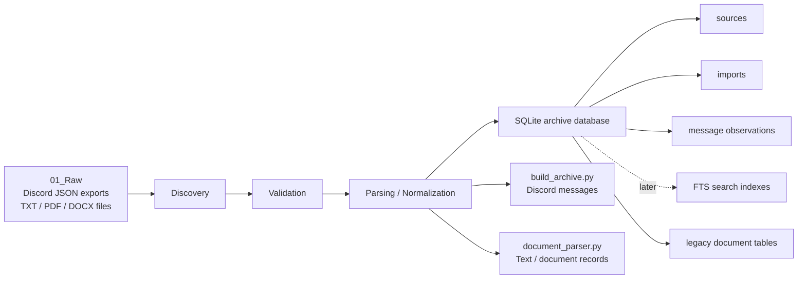
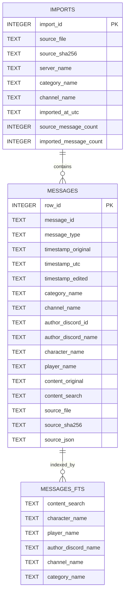
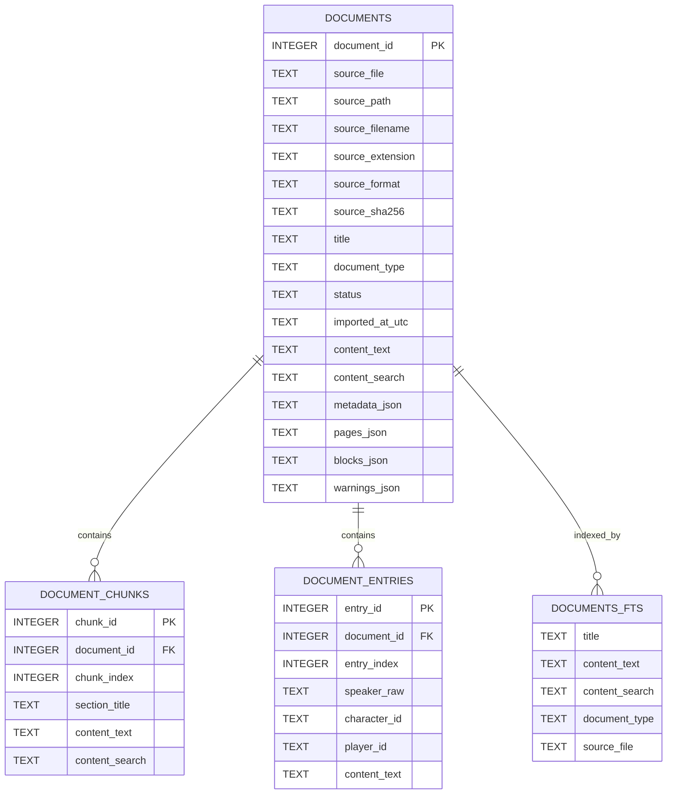
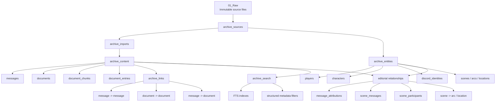
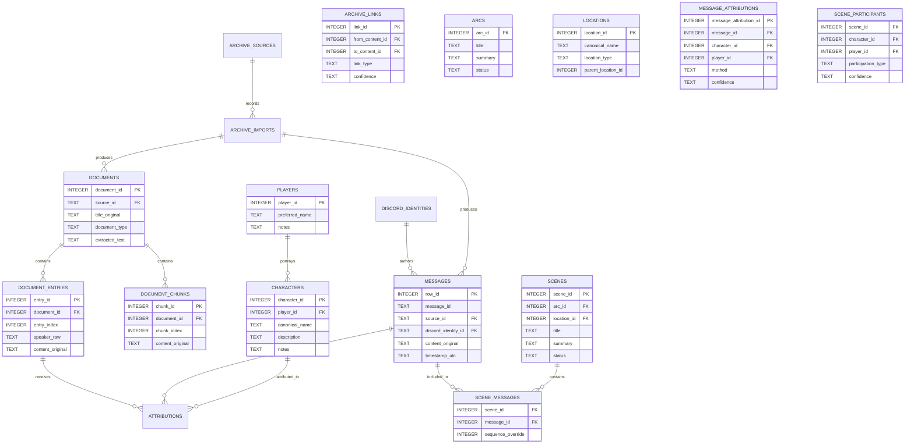

# Archive Data Model Overview

This document explains the current project architecture, the current SQLite structure, and the proposed long-term archive model in the naming conventions already used across the repository.

---

## 01 — Import Pipeline

The project currently has two ingestion paths that both end in SQLite, but they are not yet unified into a single archival model.

### Current implementation split

1. Discord pipeline: `src/build_archive.py` imports DiscordChatExporter JSON into
    `sources`, `imports`, and per-import message observations. FTS is deferred.

2. Document pipeline: `src/document_parser.py` and `src/alt_archive_builder.py`
    import TXT/PDF/DOCX into typed documents, chunks, and entries; FTS is deferred.

### Important note

The current implementation is solid for each type independently, but the database still treats Discord content and document content as separate families. The archive does not yet have a shared identity layer for:

- character
- player
- source entity
- scene
- timeline
- event
- document relationship

---

## 02 — Legacy SQLite Schema Diagram

This diagram documents the pre-migration layout. The active target schema is
documented in [Implementation Schema.md](Implementation%20Schema.md).

### What this schema does well

- Stores raw import metadata and source hashes
- Preserves original Discord message payloads
- Supports document parsing and chunk extraction
- Enables full-text searching with SQLite FTS5
- Separates provenance from extracted content

### What it still does not do well

- Unify Discord and document records under a single archival model
- Treat characters, players, scenes, and events as first-class entities
- Link message content cleanly to character attribution and narrative context
- Represent a true relationship graph beyond simple timestamps and search indexes

---

## 03 — Proposed Archive Data Model

The proposed model keeps the raw archive faithful while introducing a shared archival layer that can relate messages, documents, identities, and narrative structures.

### Proposed conceptual tables

The `archive_*` names are architectural groupings, not invitations to create
generic polymorphic rows. In particular:

- `archive_content` is the content boundary containing explicit tables such
  as `messages`, `documents`, `document_chunks`, and `document_entries`.
- `archive_entities` is the domain boundary containing explicit tables such
  as `players`, `characters`, `scenes`, `arcs`, `locations`, and Discord
  identities.
- `archive_links` is reserved for content-to-content relationships such as
    message replies, message references, quotes, document relationships, and
    citations. Its endpoints are content records.
- Editorial relationships use explicit tables such as
    `message_attributions`, `scene_messages`, and `scene_participants`. A
    message-to-character relationship is not the same kind of relationship as a
    message reply.

Do not add `content_type`, `entity_type`, or a universal JSON payload merely to
make unrelated records fit one table. Add an explicit table when the record has
different semantics, lifecycle rules, constraints, or queries.

### Design direction

The proposed archive model is not a replacement for the raw materials. Instead, it adds a structured layer that understands:

- which source file a record came from
- which identities are involved
- which content objects are related
- how Discord events and document entries connect to narrative context
- how to search and reason across both structured and unstructured material

### Key project-aligned principles

1. Preserve the raw source
   - Keep `01_Raw` immutable and hash-verified.

2. Separate raw from derived
   - `02_Processed` is where extracted, normalized, and analyzed data lives.

3. Keep content type aware
    - `messages`, `documents`, `document_chunks`, and `document_entries` remain explicit typed records within the `archive_content` boundary.

4. Model identity explicitly
    - Discord identity, player, character, bot, webhook, and narrator must be distinguishable through explicit tables and relationships.

5. Treat relationships as real archival data
    - Store content relationships in `archive_links` and editorial relationships in explicit junction or foreign-key tables. Do not infer either category only at query time.

---

## Summary

The current implementation is a strong ingestion foundation: it imports Discord exports and documents into SQLite and builds FTS indexes for search. The long-term model should keep that foundation while adding the five `archive_*` boundaries and explicit typed tables for content and domain concepts. Shared links should be introduced only where they solve a demonstrated cross-table relationship that cannot be expressed clearly with ordinary foreign keys.
